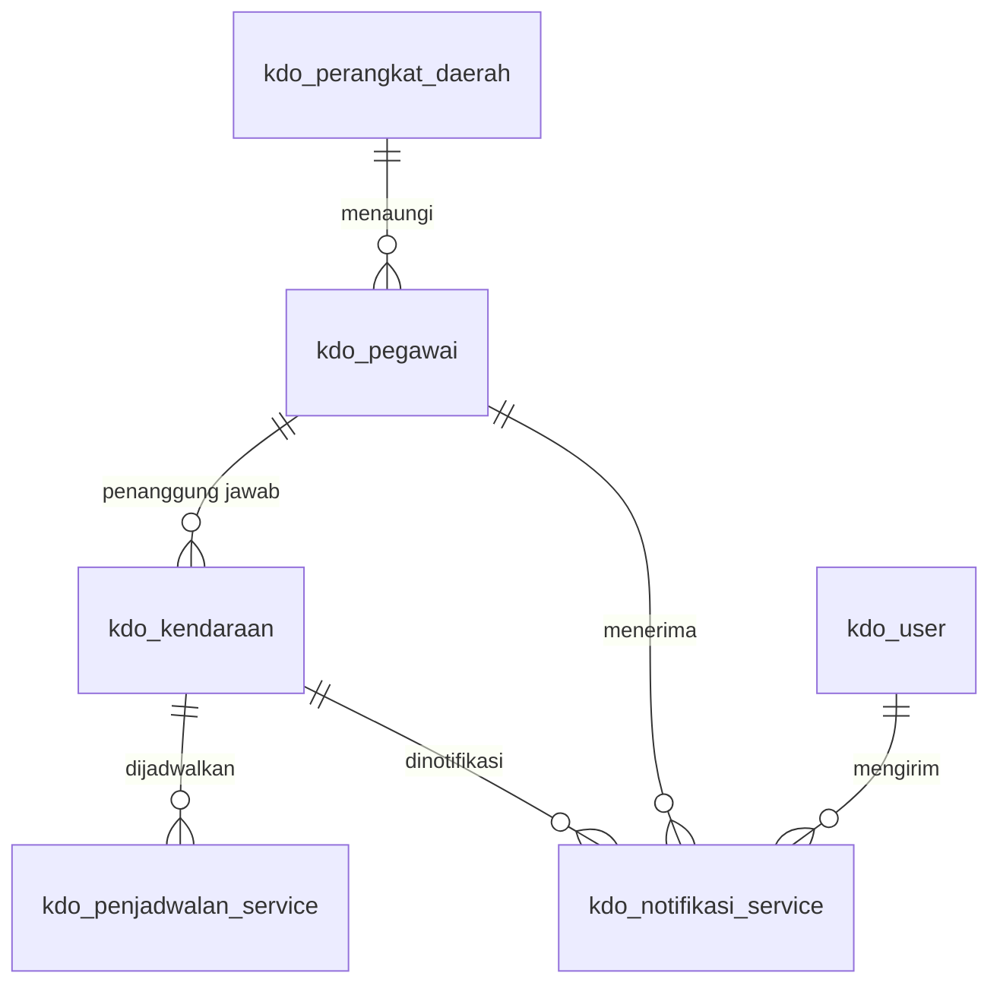

# Skema Database `kdo-apps`

Aturan penamaan: semua tabel dan field aplikasi diberi awalan `kdo_`, kecuali primary key `id`. Foreign key memakai pola `kdo_<tabel>_id`, misalnya `kdo_pegawai.id` menjadi kolom `kdo_pegawai_id`. Timestamp juga mengikuti aturan ini: `kdo_created_at` dan `kdo_updated_at`.

## ERD

> **Revisi relasi:** `kdo_perangkat_daerah_id` dipindah dari `kdo_kendaraan` ke `kdo_pegawai`. Rantai relasinya: kendaraan → pegawai penanggung jawab → perangkat daerah.

## kdo_kendaraan
| Field | Tipe | Keterangan |
| --- | --- | --- |
| id | bigint PK | |
| kdo_pegawai_id | FK → kdo_pegawai.id, wajib | Penanggung jawab; **restrict on delete**. Perangkat daerah kendaraan = perangkat daerah pegawai ini |
| kdo_nomor_polisi | varchar(15) unique | Dinormalisasi, mis. `B 1234 PQA` |
| kdo_merek | varchar(50) | |
| kdo_tipe | varchar(100) | Tipe/model |
| kdo_tahun_produksi | smallint unsigned, index | |
| kdo_warna | varchar(30) | |
| kdo_kondisi | varchar(20), index | `baik`, `rusak_ringan`, `rusak_berat` |
| kdo_status | varchar(20) | `aktif`, `dalam_service`, `tidak_aktif` |
| kdo_created_at / kdo_updated_at | timestamp | |

## kdo_pegawai
| Field | Tipe | Keterangan |
| --- | --- | --- |
| id | bigint PK | |
| kdo_perangkat_daerah_id | FK → kdo_perangkat_daerah.id, wajib | Instansi tempat pegawai bertugas; **restrict on delete** |
| kdo_nama_pegawai | varchar | |
| kdo_nip | char 18 digit, unique | |
| kdo_jabatan | varchar | |
| kdo_golongan | varchar(10) | I/a … IV/e (`config('kdo.golongan')`) |
| kdo_email | varchar nullable | **Tambahan**: tujuan email notifikasi |

## kdo_perangkat_daerah
| Field | Tipe | Keterangan |
| --- | --- | --- |
| id | bigint PK | |
| kdo_nama_perangkat | varchar unique | |
| kdo_status_perangkat | varchar(20) | `aktif`, `tidak_aktif` |

## kdo_penjadwalan_service
| Field | Tipe | Keterangan |
| --- | --- | --- |
| id | bigint PK | |
| kdo_kendaraan_id | FK → kdo_kendaraan.id | **cascade on delete** |
| kdo_service_mulai | date | |
| kdo_service_selesai | date nullable | ≥ tanggal mulai |
| kdo_keterangan | text nullable | **Tambahan**: catatan pekerjaan service |

Status jadwal **tidak disimpan**; dihitung dari tanggal hari ini: `dijadwalkan` (mulai > hari ini), `berlangsung`, `selesai` (selesai < hari ini).

## Tabel tambahan
- **kdo_user**: pengganti tabel `users` bawaan (`kdo_nama_user`, `kdo_email`, `kdo_password`, `kdo_role`, `kdo_remember_token`).
- **kdo_notifikasi_service**: riwayat email layak service (`kdo_kendaraan_id`, `kdo_pegawai_id`, `kdo_user_id` pengirim, `kdo_mode` dev/prod, `kdo_email_tujuan`, `kdo_alasan`).

## Tabel framework (nama bawaan dipertahankan)
`sessions`, `password_reset_tokens`, `cache`, `cache_locks`, `jobs`, `job_batches`, `failed_jobs`, `personal_access_tokens`, `migrations`. Nama-nama ini dipakai langsung oleh internal Laravel/Sanctum.

## Data dummy (seeder)
`php artisan migrate:fresh --seed` membuat:
- 2 user (admin & user)
- 3 perangkat daerah
- 15 pegawai (5 per perangkat daerah, 1 tanpa email)
- 24 kendaraan (8 per perangkat daerah melalui pegawai), mencakup semua kriteria layak service
- 6 jadwal service (selesai/berlangsung/akan datang)

Seeder ada di `database/seeders/*Seeder.php`, factory di `database/factories`.
